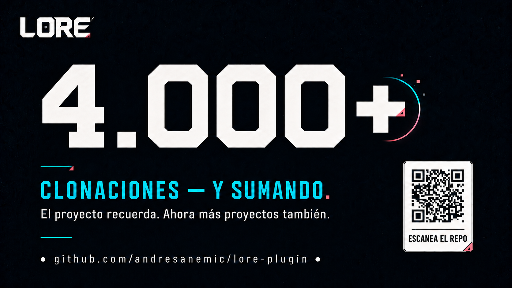

<p align="center">
  
</p>

<h1 align="center">Lore</h1>

<p align="center">
  <a href="#installation"></a>
  <a href="#installation"></a>
  <a href="./docs/SPEC_KIT_en.md"></a>
  <a href="#origin"></a>
</p>

<p align="center">
  <b>Pare de explicar seu projeto para a IA toda manhã.</b><br>
  Com a sua aprovação, Lore transforma aprendizado em critérios de projeto que a IA pode usar na proxima sessão.
</p>


<p align="center"><a href="./docs/90_SECONDS_en.md">Comece com o guia de 90 segundos →</a> · <a href="https://github.com/andresanemic/lore-plugin">Clone o repositório</a></p>

**Não sabe se deve experimentar?** Compartilhe o link desse repositório com seu agente de IA, pergunte o que são o Lore Plugin e o Vespi e deixe que ele te diga se recomenda instalá-los em um de seus projetos.

**Em palavras simples.** *Lore*: os critérios do seu projeto, na forma de arquivos Markdown simples que você aprova. *Salvar no Lore*: transforme uma correção que você fez em um critério para a próxima sessão. *Podar*: retire regras que não se aplicam mais. *Enxertar*: incorpore uma ideia externa somente depois de verificar em que pontos ela falha em relação aos seus critérios. *Transmutar*: reorganize ou migre uma árvore de critérios  do Lore. *Cristalizar*: empacote os critérios de um bot em um único arquivo para transportá-los para outro lugar.

**O futuro do projeto.** Hoje você executa o Lore Plugin a partir de um terminal. **Vespi Desktop** é o ambiente de trabalho planejado que reunirá esse kit e o kernel do Vespi, tendo o **Hive como seu estúdio de criação**. No HackMeridian, mostraremos essa direção juntamente com o que já funciona; o Desktop ainda não está disponível para instalação. [Experimente a POC interativa do Hive](https://vespi.xyz/) no site: um MVP de UX/UI onde você pode escolher agentes e salvar critérios e fluxos de trabalho no seu navegador, sem se conectar à IA.

---
<details>
<summary><b>Leia em Português</b></summary>
<a id="Português"></a>

## O problema 

Toda sessão começa em branco. As correções de ontem não passam para a próxima, então você explica o projeto de novo e pode repetir decisões que já havia rejeitado. O Lore dá ao aprendizado que você aprova um lugar nos arquivos do seu projeto, pronto para o trabalho futuro.


---

<table>
<tr>
<td width="33%" valign="top">

**Começar**

[O problema](#o-problema) ·
[O que é o Lore](#o-que-é-o-lore) ·
[Quem pode usar](#quem-pode-usar-o-plugin-lore) ·
[Comece a construir](#comece-a-construir-seu-lore) ·
[Instalação](#instalação)

</td>
<td width="33%" valign="top">

**Usar**

[Arquitetura](#arquitetura) ·
[As nove skills](#as-nove-skills) ·
[Anotações diversas](#anotações-diversas) ·
[Documentação](#documentação)

</td>
<td width="33%" valign="top">

**Entender**

[Invariantes compartilhadas](#invariantes-compartilhadas) ·
[Estudos de caso](./docs/CASES_en.md) ·
[Alcance](#alcance) · [Origem](#origem)

</td>
</tr>
</table>

---

## O que é Lore?

Lore é um kit agnóstico de provedor, composto por nove skills e uma estrutura simples para critérios de projeto. Você decide o que é escrito; o kit disponibiliza os critérios aprovados antes de trabalhos futuros. Ele não treina um modelo nem aprende por conta própria. 

#### O que ele oferece

- Uma convenção simples para organizar os critérios de um projeto.
- Nove habilidades que trabalham com essa convenção.
- Um processo com revisão humana para transformar a experiência em critérios reutilizáveis.

 Cada projeto possui um contrato (`CLAUDE.md` ou `AGENTS.md`, dependendo do host), o arquivo `FASES.md` para o trabalho atual e a pasta `lore/` com os critérios que guiam como ele é construído.


#### Comece a partir do trabalho existente

O `transmutar-lore` pode ler pastas de projetos, documentos, resumos de chats exportados e anotações para ajudar a organizar os critérios já em uso. Seus arquivos permanecem como estão; nada se torna Lore até que você leia e aprove o resultado.

Quando os critérios precisam ser transferidos, **Cristalizar** cria um snapshot rastreável em Markdown que pode ser movido entre modelos e retornar à pasta de trabalho. Ele omite nomes de arquivos confidenciais e rejeita marcadores secretos. Ele nunca substitui o Lore ativo.

#### O que ele não promete

O Lore não pode garantir um trabalho bem feito nem determinar quando os critérios antigos não se aplicam mais. Ele oferece uma maneira revisada de preservar e podar o aprendizado; ambas as tarefas ainda exigem seu julgamento e seu tempo.

#### O filtro

O Lore contém aprendizado que influencia decisões futuras. **Se uma frase não condicionar uma decisão futura, não é Lore.** Outros fatos devem constar na documentação ou nas notas.

## Quem pode usar o Plugin Lore?

Seja você um iniciante ou alguém que já tem experiência com IA, pode começar com seus próprios projetos e suas próprias palavras.

- **Iniciante em IA:** descreva o que você quer fazer; as skills guiam o próximo passo, e você aprova o que é gerado.
- **Builders Exeprientes:** carregue critérios úteis do seu projeto entre sessões e modelos.
- **Equipes que utilizam Spec-Kit ou outro fluxo de trabalho:** O Lore mantém os critérios do seu projeto junto às suas ferramentas; ele não as substitui. Consulte [`SPEC_KIT_en.md`](./docs/SPEC_KIT_en.md).
- **Leitores interessados na pesquisa:** [LUS explica as perguntas de pesquisa e até onde as evidências permitem chegar](./docs/LUS_en.md).

##  Comece a construir seu Lore

Para trabalhos que se estendem por várias sessões, o kit pode propor um breve acordo sobre seu propósito e limites; você decide se quer utilizá-lo. Quando uma tarefa deixa um aprendizado que vale a pena levar adiante, Lore pode transformá-lo em uma **Pista Invariante**: uma pequena regra que você pode reutilizar posteriormente.

| Ao invés de lembrar | Lore guarda |
|---|---|
| "A IA escreveu um relatório técnico demais para o leitor" | "Antes de redigir, identifique quem vai ler o texto e explique todos os termos técnicos em linguagem simples" |
| "Um resumo da reunião omitiu quem era o responsável por cada tarefa" | "Cada resumo de reunião termina com cada tarefa, seu responsável e seu prazo" |

### O loop

<p align="center">
  
</p>

Cada aprendizado é proposto, analisado e aprovado antes de ser escrito. O Lore carrega os critérios aprovados antes do início do trabalho. A afirmação de que a experiência acumulada influencia decisões posteriores é uma hipótese de pesquisa, não um mecanismo comprovado; [o LUS documenta essa limitação](./docs/LUS_en.md).

---

## Installation

The clearest provider-neutral route is to clone the repository: the source stays visible, updates remain ordinary Git operations, and the same checkout can prepare Claude Code and Codex. It requires Git and Node.js.

### Recommended — clone the repository

```bash
git clone https://github.com/andresanemic/lore-plugin.git
cd lore-plugin
node scripts/lore-plugin.mjs install --target all
codex plugin add lore@personal
```

To target one host, replace `all`. OpenCode receives Lore's skills, hooks and TUI mark.

If you already use a host plugin manager, these shorter routes install the same package without keeping a separate checkout.

### What the installer touches, and how to go back

`install` writes to your user directory, never to your projects. To see it first, run it with a throwaway home: `HOME=$(mktemp -d) node scripts/lore-plugin.mjs install --target opencode` (on Windows, point `HOME` and `USERPROFILE` at an empty folder).

- **OpenCode:** `~/.config/opencode/skills/` (the Lore skills), `plugin/` and `plugins/` (the hook and the status mark), `lore-plugin.json` and one entry in `tui.json`; plus `~/.lore-plugin/`.
- **Codex:** `~/.agents/plugins/plugins/lore/`, an entry in `~/.agents/plugins/marketplace.json` and `~/.lore-plugin/`; then `codex plugin add lore@personal` registers it in Codex.
- **Claude Code:** the plugin goes through Claude Code's own marketplace; remove it with Claude Code's plugin commands.

There is no uninstall command yet. To go back, delete the paths above, and remove the status mark with `node scripts/lore-plugin.mjs statusline uninstall`. If you keep your own configuration in `~/.config/opencode`, back it up first.

### Claude Code

Run these commands inside Claude Code:

```bash
/plugin marketplace add andresanemic/lore-plugin
/plugin install lore@lore-plugin
```

Or run their CLI equivalents from a terminal:

```bash
claude plugin marketplace add andresanemic/lore-plugin
claude plugin install lore@lore-plugin
```

To connect the visible status mark after installing through Claude's plugin manager, run from the repository clone:

```bash
node scripts/lore-plugin.mjs statusline install
```

### Codex CLI

Run these commands in your terminal:

```bash
codex plugin marketplace add andresanemic/lore-plugin
codex plugin add lore@lore-plugin
```

<details>
<summary><b>Other hosts — copy from the same clone</b> (OpenCode, Cursor, Antigravity)</summary>

<br>

### OpenCode

Install Lore's skills, hooks and TUI mark globally:

```bash
node scripts/lore-plugin.mjs install --target opencode
```

Restart OpenCode. Existing `tui.json` entries are preserved; `tui.jsonc` is left untouched. For one project, use `.opencode/skills/` instead.

- For non-interactive delegates, configure routed access with `lore-plugin opencode-permissions --project <dir> --from-routing [--write]`, or prepare a confined profile with `lore-plugin opencode-sandbox <dir>`. The reference explains stdin, `-f` ordering and temporary-directory requirements.

### Cursor

Cursor already discovers skills installed under `~/.codex/skills/` or `~/.agents/skills/`. To keep
a separate Cursor copy, use its global directory and restart Cursor:

```bash
mkdir -p ~/.cursor/skills
cp -R skills/* ~/.cursor/skills/
```

### Google Antigravity

Antigravity loads global skills from `~/.gemini/config/skills/` and workspace skills from
`.agents/skills/`. From a local clone:

```bash
mkdir -p ~/.gemini/config/skills
cp -R skills/* ~/.gemini/config/skills/
```

Restart Antigravity after copying them.

Claude Code does not receive routine hook context: its adapter is deliberately absent because anything handed to the agent can become visible or alter the reply. Its red-only `PreToolUse` guard classifies structured file destinations from the session tree, an existing shared `intercambio/`, its scratchpad, routed sibling trees and session memory, anchored at `SessionStart` rather than a drifting shell `cwd`. **Own** passes. **Foreign** asks the host for approval before the structured file operation: `ask` prompts the person, `allow` can run without prompting, `deny` blocks. Choose `once` for a single operation; the plugin stores no `always`. A host-level deny still wins. Shell and indirect writes stay under the host sandbox policy; this adapter grants none. **Unknown** passes with a notice and is written down. Codex also keeps its automatic local guard through silent `SessionStart` and `PostToolUse`. OpenCode's native `external_directory` and `edit` permissions decide foreign structured writes: `ask` prompts, `allow` may pass silently, `deny` blocks. Choose `once`; the hook cannot select it or save grants. Shell and indirect writes follow host policy. In every host, `use-lore` checks body-load integrity at session opening: a clean check says nothing, a missing connection names only the decision needed. One opening exception, on both hosts since 2.4.8: inside a federated bot whose always-on block does not declare its load, `SessionStart` names the repair (`lore-plugin mycelium federated`) in exactly one line; green stays at zero bytes and everything fails open. `FASES.md` and `PHASES.md` remain state and do not enter the receipt.

</details>

Then open a new CLI session. **If this is your first time, you need no command** — write *«I want to start using Lore Plugin, help me»* and the kit opens a **brainstorming, not a menu**: it receives you first, then looks at your tree, asks one question at a time, and ends with your **first artifact created**, never with a recommendation. It also offers a collaboration agreement: choose a more reserved or warmer tone, a slow, normal or fast pace (warm and normal by default), and your usage limits: which model families or effort levels must never be used. Families are named without version numbers so a provider update does not tie you to an old model. If you already know what you want, `use-lore` routes you.

If you used an earlier version, the update brings one short message, once: Vespi has arrived, what it can do for you, and an invitation to set your limits.

One question at a time is not a courtesy, and a form would be faster. The questions are what keep you and the model two things instead of one — no fusion, and no sparing each other the friction — long enough for an answer neither of you had alone.

## What it looks like in practice

You want a website for your pottery workshop and have never made one. You say it plainly:

```text
› I want to make a website for my workshop and don't know how
```

Before writing a line, Lore Plugin proposes an agreement:

```text
  Before we start, let's agree on a few things. It's short,
  and you can change it whenever you want.

  What it's for ············· people see your pieces and
                             message you to order
  I need your word to change your photos and prices
  Where I have room ········· design and layout
  What we try ··············· a gallery per collection;
                             if you don't like it, we change it
  Room to surprise you ······ how each piece is presented
  How I speak to you ········ warmly, at a normal pace
  I'll ask again ············ before publishing

  Does that work for you?
```

You say yes, and it is written down. You can work calmly: the agreement holds without constant supervision, and anything new that falls outside it is brought to you first.

Two weeks later the website has a store, a cart and shipping, and you find yourself writing:

```text
› this is getting too complicated for me
```

This time Vespi responds, the part of the kit that keeps the agreement in view:

```text
  According to the notes, we've spent three sessions on the
  store, but the agreement said orders by message. I think
  the store was added along the way.

  Shall we add it to the agreement, or return to what we
  agreed and leave it for later?
```

You decide. And when something goes wrong and you fix it, what you learned can be saved too. You just shipped a landing page and the feedback is: "I didn't know what to do on the page." The CTA was below the fold and the headline talked about the product, not the outcome. You fixed it. Instead of closing the tab:

```text
› save to lore
```

```text
  Distilled this:

  [cta] CTA not visible — headline without outcome

  Context ······· landing page had the CTA below the fold
  Root cause ···· headline described the product, not the
                  result for the reader
  Clue ·········· place the main CTA above the fold and
                  write the headline around the outcome,
                  not the feature
  Confidence ···· confirmed — fixed on live page

  → projects/client-a/lore/cta.md
  → this clue is generic and confirmed: promote it to the Area
    so the other 3 projects see it?

  Write it?
```

Three months later, another project in the same Area ships a landing page. The criteria is already loaded, so that mistake does not happen again.

> None of it was written without a human saying yes. The same gate governs all nine skills.

---

## Architecture

### The six pieces

Every project organizes its criteria and state into six structural pieces. They are not necessarily six files: thematic modules are one piece, implemented across as many focused files as the work requires.

| Piece | What it holds | Where |
|---|---|---|
| `identidad.md` | What the project is, its purpose and its **quality floor** | `lore/` |
| `principios.md` | Invariant laws, technical and business: prohibitions and imperatives | `lore/` |
| Thematic modules | Technical scars by domain (animation, layout, scroll…) | `lore/` |
| `index.md` | Navigation map: one line per pattern | `lore/` |
| `FASES.md` | State and roadmap: current phase, focus | root |
| `CLAUDE.md` **or** `AGENTS.md` | One collaboration contract, selected by primary host and slimmed to **pointers** | root |

Each has one responsibility. None duplicates another.

> **Lore is criteria (it persists); `FASES.md` is state (it advances).** They never mix, and `FASES.md` never lives inside `lore/`.

They are kept apart because they age at different speeds: who you are and how you work stay true next month; which phase the project is in does not. Mixing them means re-reading a document where half the sentences expired and nothing says which half.

The canonical names are Spanish; in your language they are localized.

#### The always-on block

The contract is the only artifact **both** hosts load without being asked, which is why Lore stamps
a delimited pointer section into it — the kit's always-on channel to the session.

<details>
<summary><b>The exact mechanics</b> (ceiling, variants, how it gets stamped)</summary>

<br>

```markdown
<!-- lore:always-on -->
…what Lore governs here · where it lives · where the state lives · when to invoke instead of writing by hand…
<!-- /lore:always-on -->
```

Four items and no more, under a hard ceiling of **25 lines**, pointing to `lore/` and to `FASES.md`: criteria and state live apart, but a session that receives the criteria without the phase proposes the right thing at the wrong time. Three variants — an **area** to its own `lore/`, a **project** to its own layer and its mother area's, a **bot** to `canon/` and its **routing table**, never to the federated Lores one by one, which is why a bot reaching twenty bodies of criteria still fits. The block never reproduces a clue; the owning skills stamp it idempotently, and a hand-edited divergence is reported, never overwritten.

</details>

### Area → Project inheritance

Lore scales through **Areas**. An Area is a mother folder with its own Lore, and projects inherit it instead of copying it:

```text
web-development/
│
├── lore/                      ← general criteria lives ONCE
│     identity · principles · index · animation · scroll · layout
│
├── PHASES.md                  ← the Area's project registry
├── CLAUDE.md or AGENTS.md     ← the Area's one host-selected contract
│
└── projects/
    ├── client-a/
    │   └── lore/              ← only its own; the index points at the Area
    ├── client-b/
    │   └── lore/
    └── client-c/
        └── lore/
```

Fix a generic clue once in the Area and every project sees it. Each project keeps only what is truly its own — the system stays DRY without losing accumulated experience.

### The third shape: a bot

| | Area | Project | **Bot** |
|---|---|---|---|
| Holds | projects | one piece of work | **a work session** |
| Its Lore governs | the domain's method | that work | **how the agent behaves** |
| Opened to | see the registry | advance that work | **work on any of several projects** |

Areas and projects are places; **a bot is a lens you carry into them.** An Area that collects criteria it never earned starts receiving promotions that belong somewhere else.

---

## The nine skills

**This kit moves with Superpowers' `writing-skills` discipline, not past it.** Every changed skill is checked against it before it ships; the latest record is [`bench/writing-skills-2.4.1/README.md`](./bench/writing-skills-2.4.1/README.md), with the 2.4.0 loose-note and 2.3.3 audit records.

> **The skills are written in English; the Lore they produce is not** — content and filenames included, in your language. Do not open one to explain a mode to someone (we learned this in Case 12, live) — that is what the table and the two docs below are for.

| Skill | What for | When |
|---|---|---|
| `use-lore` | Entry point: explains the model and routes you to the right skill | first, always |
| `brainstorming-lore` | Designs Lore artifacts, or deliverables governed by routed process modules, without taking over generic ideation; preserves recognizable continuity and fertile effort | before a material Lore change or governed design |
| `create-area` | Creates an Area with its shared Lore | opening a new domain |
| `create-project` | Creates a project that inherits from the Area | starting a piece of work |
| `save-to-lore` | Distills a lesson, or mines a loose-notes inbox, and decides whether it rises to the Area | every day |
| `transmute-lore` | Migrates, cleans, translates, upgrades, prunes or exports a safe snapshot of Lore | inheriting, maintaining, updating or sharing Lore |
| `create-bot` | One place to open a session and work across several Areas at once | from zero, or once there is Lore to federate |
| `vespi` | The kernel that keeps a bounded operation alive across sessions: continues, moves laterally, revalidates before continuing | whenever an operation must stay alive; pressure is one case, not the gate |
| `stale-lore` | Verifies which published kit capabilities have gone unexercised and withdraws them declaratively — with a changelog so the withdrawal itself is auditable | reconciling promise against evidence; when the kit's published surface needs to shrink |

**Day one needs two of these:** `use-lore` routes you to whatever comes next, and `save-to-lore` is the one you will actually type — *"save to lore"*, after solving something that cost you. **Getting started, day-to-day use and the full mechanism for every skill and mode** live in one place: [`REFERENCE_en.md`](./docs/REFERENCE_en.md).


---

## Vespi

**Vespi is the kernel under Lore Plugin. This cut carries frozen kernel 0.1.6.** Reviewed, not audited: the only reviews so far are our own superreviews with Claude Code, and there is no independent external security audit.

<p align="center">
  
</p>

Lore Plugin is the ground: your criterion, written once, and the routing that opens the right one for each task. Vespi is what runs on that ground: an operation under an authority you grant, checked apart from whoever carries it out, that leaves a receipt anyone can verify. It does not write your Lore and it does not decide for you: it says what it sees, states its assumptions as assumptions, and the choice is yours.

Version 2.5.2 makes the next action explicit when a session opens. Coordinated ordinary work leaves an operation record, and verification runs a commissioned check before certification. Rejected results remain visible and require fresh review after correction. Deterministic checks and explicitly authorized semantic review have different limits; execution does not guarantee judgment. [Release notes](./docs/RELEASE_2.5.2.md) · [Execution and limits](./docs/VERIFICATION-EXECUTION.md).


**Vespi Meridian Edition 1.0:** [Website — vespi.xyz](https://vespi.xyz) · [Demo video](https://www.youtube.com/watch?v=g2iw29M6WI0) · [Tutorial in English](https://docs.google.com/document/d/1gwu3gBIJwgevCrGPyMv-J1UfjegggYDu/edit?usp=sharing&ouid=113358117411001923633&rtpof=true&sd=true) · [LUS + Lore Plugin deck in English](https://drive.google.com/file/d/1lG5DOOS6z4Kzz6PfZIPP2RXW_LXN_U1g/view?usp=drive_link).

### Where the pieces fit

| Project | Its focus | Lore Plugin + Vespi today |
|---|---|---|
| [TencentDB Agent Memory](https://github.com/TencentCloud/TencentDB-Agent-Memory) | Shared, governed agent memory, skills, wiki and code graphs | Human-approved project criteria plus bounded operations and receipts |
| [Hermes Agent](https://github.com/NousResearch/hermes-agent) | An agent runtime with persistent memory and skills | Criteria carried across supported hosts; operation authority outside any one agent runtime |
| [Obsidian](https://obsidian.md/help/data-storage) | Local Markdown notes and linked knowledge | A workflow for promoting experience into agent-readable criteria with approval |
| [Graphify](https://github.com/Graphify-Labs/graphify) / [CodeGraph](https://github.com/colbymchenry/codegraph/blob/main/site/src/content/docs/getting-started/introduction.md) | Queryable code structure; Graphify also maps documents | Maintained project criteria and authority for concrete operations |

This compares current scope, not head-to-head results. The Desktop end-to-end path remains to be demonstrated.

## Loose notes

Create a `notes/`, `notas/`, or `apuntes/` folder in the project, Area or bot where you work; any editor works. To have the AI read it, ask:

> “Review my notes and check whether anything can be saved to my Lore.”

`save-to-lore` loads its notes procedure, reviews the whole folder, separates criteria from tasks and noise, proposes the owning Lore and waits for your approval. It marks each mined note with its date and destination and never deletes it. **A note is a source, never criteria**: nothing crosses without explicit distillation and an approved diff.

The kit also leaves notes: what it offers to save is first written outside your Lore; what later carries weight is offered to `save-to-lore`, which remains the only gate. Vespi leaves notes in the same way. If its suggestion is technical (a hook, a cron or a handoff), it first asks whether you know what that is and explains it plainly if you do not.

## Shared invariants

All nine skills follow the same rules:

- Lore is written **in your language**.
- **Criteria is never invented.** It comes from real experience.
- **A note is a source, never criteria.**
- **Discarded noise is reported**, never silently deleted.
- Every change passes a **threshold** before it is written.
- **Nothing commits automatically.** You review the final diff.

Your criteria stays in files you own. The kit never writes or commits it without your approval.


## Documentation

This README covers motivation and architecture. Everything else lives in its own document:

| Document | What it's for |
|---|---|
| [`90_SECONDS_en.md`](./docs/90_SECONDS_en.md) | **Start here.** The whole mechanism, short enough to read before deciding whether to install anything. |
| [`WHY_LORE_IS_AN_OS_en.md`](./docs/WHY_LORE_IS_AN_OS_en.md) | Why this is called an operating system, and the limits it declares: not a computer OS, no mainnet, no production claim. |
| [`REFERENCE_en.md`](./docs/REFERENCE_en.md) | **The technical document.** Getting started, day-to-day use, core concepts, the exact spec for each skill, mode and artifact, and how to migrate an existing project. |
| [`CASES_en.md`](./docs/CASES_en.md) | The nineteen case studies, each with its declared boundary. |
| [`SPEC_KIT_en.md`](./docs/SPEC_KIT_en.md) | Lore alongside GitHub's spec-kit: who governs what. Optional — Lore never depends on it. |
| [`LUS_en.md`](./docs/LUS_en.md) | The research program behind Lore, its current hypotheses and evidence boundaries. |
| [`GENEALOGY_en.md`](./docs/GENEALOGY_en.md) | Affective genealogy: cultural provenance kept separate from theory and product rules. |
| [`BIBLIOGRAPHY_en.md`](./docs/BIBLIOGRAPHY_en.md) | Conceptual sources: the entry rule, and where each one loses. |
| [`OBSERVER_en.md`](./docs/OBSERVER_en.md) | Observer provenance: the third registry — its method is published, its content does not travel. |
| [`CONTRIBUTING_en.md`](./docs/CONTRIBUTING_en.md) | How to contribute product changes, cases, refutations and research questions. |
| [`CODE_OF_CONDUCT.md`](./docs/CODE_OF_CONDUCT.md) | Participation standards and reporting route. |
| [`LICENSE`](./LICENSE) · [`NOTICE`](./NOTICE) | Apache License 2.0, and it stays open source: the commitment is in `NOTICE`, with authorship. |
| [Read the benchmark →](./bench/effect-2.3.2/) | Method, evidence, limits, and reviewable results. |

---

## Case studies

Lore was not designed ahead of time: every decision came from applying it to real projects and watching what broke — documented as **nineteen case studies**, each with its declared boundary. **Case 12 is the first install run by someone who is not the author.**

> **Status:** cases, not proofs — small n, and **eighteen of the nineteen come from the same researcher**. The measured claim belongs to Case 08; the rest are qualitative evidence.

**[Read the nineteen case studies →](./docs/CASES_en.md)**

---

## Reach

<p align="center">
  
</p>

<p align="center">
  <a href="./data/traffic/clones.json"></a>
  <a href="./data/traffic/clones.json"></a>
  <a href="./data/traffic/clones.json"></a>
  <a href="./data/traffic/clones.json"></a>
</p>

**4,000+ recorded clones since launch** (4,415 through 2026-10-12: 4,057 preserved through 2026-10-10 plus 358 from the GitHub API for October 11–12; clones, not unique people). GitHub traffic windows preserved in [`data/traffic/clones.json`](./data/traffic/clones.json). A **recorded minimum, consulted on 2026-10-13; latest completed API day: 2026-10-12 (UTC)**. [Source response](./data/traffic/source-2026-10-13.json). The current day is excluded.

Lore Plugin is the technical arm of LUS, not a productivity system with philosophy attached. The product measure tests a narrow claim; it does not validate LUS as a whole. [The research boundary is explicit here.](./docs/LUS_en.md)

Morin gives this work its ethical north: in UNESCO's [*Seven Complex Lessons in Education for the Future*](https://unesdoc.unesco.org/ark:/48223/pf0000378091) he writes that “the notion of wager should be generalized to every faith” (our translation). [The sensibility that made such questions thinkable lives here.](./docs/GENEALOGY_en.md)

> **A reach signal, not a demonstration.** Nobody knows what anyone did with their copy — installed, distilled, opened once? It is no case, and answers none of the questions the [case studies](./docs/CASES_en.md) do. And the API's "unique cloners" are unique **per day**, not people: they cannot be summed into a headcount.


---

## Origin

Lore was born from **LUS (Lore User System)**, a research program about relations that accumulate criteria capable of participating in later decisions. Lore is one operational architecture produced by that work, not a demonstration of the program. One idea links them:

> **Experience only creates value when it can participate in a future decision.**

That makes us **gardeners of the Between**: we preserve the experiences that deserve to orient another decision and prune those that no longer constrain anything. Research and software remain separate: a product observation is not automatically a scientific result, and a hypothesis does not become a skill rule without evidence and review.

Read the full [LUS research overview](./docs/LUS_en.md), its [conceptual bibliography](./docs/BIBLIOGRAPHY_en.md), and the separate [affective genealogy](./docs/GENEALOGY_en.md).

### Why "Lore"?

In video games, *lore* is the accumulated story and rules that keep a universe coherent — what can and cannot happen next. We borrow the image and shift the weight: specific events fade, and **what remains is the criteria** that keeps the next work coherent. The visual debt is explicit too: the anime palette comes from ***Tales of Berseria*** (Bandai Namco, 2016), the author's favorite game.

## Author

**Andrés Peña Mellado** — principal researcher of LUS.

Building in Web3 — General Editor of the community journalism pilot at **Tellus Cooperative**;
formerly on the editorial teams of **Polkadot Español** and **BeInCrypto**.

He helped establish UTEM's **Design Thinking** course and taught it from 2023 to 2025. **Speaker at
[KCD El Salvador 2023](https://www.credly.com/badges/ad17002a-16be-474b-ada4-d7ba0df3a0fd)**.

<p>
  <a href="https://github.com/andresanemic"></a>
  <a href="https://x.com/andresanemic"></a>
  <a href="https://www.linkedin.com/in/andresanemic/"></a>
  <a href="https://t.me/andresanemic"></a>
  
  <a href="mailto:a.leonardopm@gmail.com"></a>
</p>

